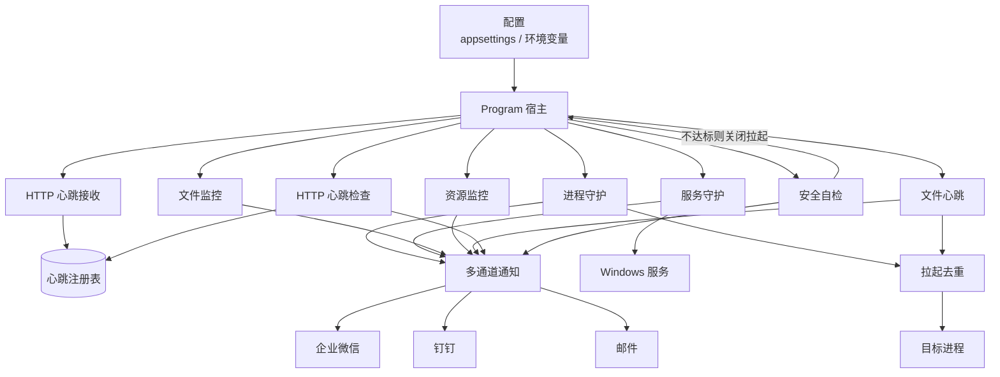

# NightWatch

[](LICENSE)

Windows 看门狗服务。以 LocalSystem 运行时，可监控进程、Windows 服务、日志文件、系统资源和心跳，异常时告警，并可按配置自动拉起目标。

通知支持企业微信、钉钉（加签）和 SMTP 邮件，可同时启用；告警按规则冷却，恢复时推送一次通知。告警标题前缀为「守夜人」。

完整配置模板见 `src/NightWatch/appsettings.example.json`（发布目录中同样带有该文件）。

## 目录

- [环境要求](#环境要求)
- [功能](#功能)
- [架构](#架构)
- [部署](#部署)
- [配置说明](#配置说明)
- [运维](#运维)
- [常见问题](#常见问题)
- [项目结构](#项目结构)
- [开发](#开发)

## 环境要求

- Windows 10 / Windows Server 2016 或更新
- 框架依赖发布：目标机安装 [.NET 10 运行时](https://dotnet.microsoft.com/download)（含 ASP.NET Core）
- 自包含发布：目标机不必装运行时，体积更大
- 注册服务、自动启动其他 Windows 服务：管理员权限
- 建议安装到非系统盘，例如 `D:\NightWatch`
- 配置里的路径一律用**绝对路径**。服务工作目录是 `C:\Windows\System32`，相对路径会指错位置

## 功能

| 模块 | 监控内容 | 异常动作 |
|------|----------|----------|
| 进程守护 | 进程是否存活、窗口是否无响应 | 告警；配置了可执行路径则可拉起 / 强杀重启 |
| 服务守护 | Windows 服务是否停止或暂停 | 告警；`AutoRestart` 与 `AllowLaunch` 都为 true 时启动或继续 |
| 文件监控 | 日志停更、文件过大 | 告警 |
| 文件心跳 | 心跳文件超过阈值未更新 | 告警；配置了可执行路径则可结束旧进程并拉起 |
| HTTP 心跳 | 多产品、多用户上报超时 | 告警 |
| 资源监控 | CPU、内存、磁盘剩余空间 | 告警 |

未配置的模块不会启动。进程与文件心跳同时守护同一可执行文件时，按路径去重，避免拉起双实例。自动拉起若持续没能让目标恢复健康，会按尝试次数退避（含启动成功但马上又退出的次数），达到上限后停止拉起并要求人工处理。启动时已健康的规则不推送；从异常恢复时推送一次。

## 架构

未配置的模块不会注册。进程守护与文件心跳拉起同一可执行文件时，经去重协调器共用一次启动权。通知进入有界队列后由后台并行发送，单通道失败不影响其他通道，也不会拖住监控检查。



## 部署

以下命令在**管理员**命令提示符或 PowerShell 中执行。把 `D:\NightWatch` 换成实际安装目录。

### 发布

开发机安装 [.NET 10 SDK](https://dotnet.microsoft.com/download) 后：

```bat
git clone <仓库地址>
cd NightWatch
dotnet publish src\NightWatch -c Release -r win-x64 --self-contained false -o D:\NightWatch
```

框架依赖：目标机安装 .NET 10 运行时即可，不必装 SDK。

目标机不能装运行时时，改为自包含：

```bat
dotnet publish src\NightWatch -c Release -r win-x64 --self-contained true -o D:\NightWatch
```

也可从 GitHub Actions 的 `NightWatch-win-x64` 制品下载后解压到安装目录（框架依赖）。

### 编写配置

```bat
copy D:\NightWatch\appsettings.example.json D:\NightWatch\appsettings.json
notepad D:\NightWatch\appsettings.json
```

`appsettings.json` 含凭据，不要提交到 Git。按环境删掉不用的规则和通道，不要留示例路径。每条规则的 `Name` 在同类中必须唯一。配置文件允许 `//` 注释。

上线前先在前台跑一次，确认配置能加载：

```bat
cd /d D:\NightWatch
NightWatch.exe
```

控制台无报错后 `Ctrl+C` 退出，再注册为服务。

### 验证通知

至少配置一个通知通道后：

```bat
NightWatch.exe --test-notify
NightWatch.exe --test-notify --test-message "主机A通知通道验证"
```

到对应群或邮箱确认能收到消息。退出码可直接用于脚本判断：全部通道成功为 `0`，任一通道失败或没有可用通道为 `1`（原因逐条打印）。QQ 邮箱使用 SMTP 授权码，不是登录密码；587 端口配合 `"UseSsl": false`（STARTTLS），465 配合 `"UseSsl": true`。

### 收紧目录权限

安装目录、被守护程序目录、心跳文件目录都不要对 Users / Everyone 开放写权限。更新程序用专用部署组：

```bat
net localgroup APP_DEPLOYERS /add
net localgroup APP_DEPLOYERS 运维账号 /add
icacls D:\NightWatch /inheritance:r /grant:r "Administrators:(OI)(CI)F" /grant:r "SYSTEM:(OI)(CI)F" /grant:r "Users:(OI)(CI)RX"
icacls D:\apps\myapp /inheritance:r /grant:r "Administrators:(OI)(CI)F" /grant:r "SYSTEM:(OI)(CI)F" /grant:r "APP_DEPLOYERS:(OI)(CI)M" /grant:r "Users:(OI)(CI)RX"
```

自检只拦截内置宽泛组。自定义组（如 `APP_DEPLOYERS`）可写不会被禁用拉起。

### 开启安全自检

NightWatch 默认以 SYSTEM 按配置拉起进程。目标 exe 或配置文件对普通用户可写时，存在本地提权风险。

多用户机器建议打开自检。**关闭权只认环境变量或命令行**，不要写在 `appsettings.json` 里：

```bat
setx WatchDog__EnableStartupSecurityCheck true /M
```

单管理员机器可设 `false`，或不设（默认关闭）。修改系统环境变量后需要重启服务才能生效。

自检开启后：用 SID 检查安装目录、全部 `appsettings*.json`、规则里的可执行文件和心跳文件。宽泛组可写、所有者不是 SYSTEM/Administrators、或 ACL 读失败时，**只关闭自动拉起**，监控和告警继续。开发环境（`dotnet run`）不检查安装目录和配置文件，避免 bin 目录误报。

配置或安装目录不可信时，文件里的 `"EnableStartupSecurityCheck": false` 无效。

### 注册服务

```bat
sc create NightWatch binPath= "D:\NightWatch\NightWatch.exe" start= auto
sc description NightWatch "NightWatch 看门狗服务"
sc start NightWatch
sc query NightWatch
```

`binPath=` 后面的空格不能少。服务账户保持 LocalSystem，以便拉起进程和启动其他服务。

若提示服务已存在：先 `sc stop NightWatch` 再 `sc delete NightWatch`，然后重新 create。

### 确认运行

```bat
sc query NightWatch
dir D:\NightWatch\logs
```

日志在安装目录 `logs\nightwatch-*.log`，按天滚动，保留 30 天。启动横幅会打印已加载的规则数量和通知通道。

若自检禁用了拉起，日志中有 `[安全自检]`，告警也会带 `icacls` 示例。收紧权限后重启服务即可恢复拉起。

### 更新

保留现有 `appsettings.json` 和 `logs`，只替换程序文件：

```bat
sc stop NightWatch
dotnet publish src\NightWatch -c Release -r win-x64 --self-contained false -o D:\NightWatch
sc start NightWatch
```

`dotnet publish` 默认不覆盖你手改的 `appsettings.json`（该文件不在仓库里）。若发布目录里混入了示例配置，先备份再发布。

### 卸载

```bat
sc stop NightWatch
sc delete NightWatch
```

再按需删除 `D:\NightWatch`。系统环境变量可保留，或：

```bat
reg delete "HKLM\SYSTEM\CurrentControlSet\Control\Session Manager\Environment" /v WatchDog__EnableStartupSecurityCheck /f
```

## 配置说明

全部选项在 `appsettings.json` 的 `WatchDog` 节。不需要的数组留空或不写，对应监控器不会启动。

| 节 | 作用 | 主要字段 |
|----|------|----------|
| `Notify.Channels` | 通知通道，可叠加 | `Type`：`wecom` / `dingtalk` / `email` |
| `Processes` | 进程守护 | `Name`、`ProcessName`、`FilePath`（空则只告警）、`Arguments`、`WorkingDirectory`、`RestartIfNotResponding` |
| `Services` | 服务守护 | `Name`、`ServiceName`（`sc query` 的服务名，不是显示名）、`AutoRestart`、`AllowLaunch` |
| `Files` | 文件 / 日志 | `Name`、`Path`、`Pattern`、`StaleMinutes`（0 关闭）、`MaxSizeMB`（0 关闭） |
| `FileHeartbeats` | 文件心跳 | `Name`、`HeartbeatFile`、`StaleMinutes`、可选 `ProcessName` / `FilePath` |
| `HttpHeartbeat` | HTTP 心跳 | 见下文 |
| `Resources` | 资源 | `CpuPercent`、`MemoryPercent`（0 关闭）、`Disks` |

监控项通用字段：`IntervalSeconds`（最短 5 秒）、`CooldownMinutes`。每条规则按自己的间隔检查。存活判定和结束进程以可执行文件完整路径为准，不用同名进程冒充；配置了 `FilePath` 时会按可执行文件名自动枚举，因此 `ProcessName` 与实际文件名不一致也不会漏判。

### 通知通道

```jsonc
"Notify": {
  "Channels": [
    {
      "Type": "wecom",
      "Name": "企业微信群",
      "WebhookUrl": "https://qyapi.weixin.qq.com/cgi-bin/webhook/send?key=xxx"
    },
    {
      "Type": "dingtalk",
      "Name": "钉钉群",
      "WebhookUrl": "https://oapi.dingtalk.com/robot/send?access_token=xxx",
      "Secret": "SECxxxx"
    },
    {
      "Type": "email",
      "Name": "邮件告警",
      "SmtpHost": "smtp.qq.com",
      "SmtpPort": 587,
      "UseSsl": false,
      "Username": "you@qq.com",
      "Password": "SMTP授权码",
      "From": "you@qq.com",
      "To": ["boss@qq.com"]
    }
  ]
}
```

钉钉机器人若启用加签，必须填 `Secret`。邮件未配 `SmtpHost` 时该通道会被跳过并记日志。各通道并行发送，互不影响。

### 进程守护

```jsonc
"Processes": [
  {
    "Name": "业务主程序",
    "ProcessName": "myapp",
    "FilePath": "D:\\apps\\myapp\\myapp.exe",
    "Arguments": "",
    "WorkingDirectory": "D:\\apps\\myapp",
    "IntervalSeconds": 30,
    "CooldownMinutes": 10,
    "RestartIfNotResponding": false
  }
]
```

`FilePath` 为空则只告警不拉起。`RestartIfNotResponding` 仅对有窗口的进程有效。强杀重启同样受 `AllowLaunch` 与退避熔断约束：安全自检禁用拉起、或连续拉起已达上限时只告警、不结束进程，避免把目标留在「已死且不会拉起」的状态。`WorkingDirectory` 留空（或不写）时，子进程工作目录为可执行文件所在目录。

### 服务守护

```jsonc
"Services": [
  {
    "Name": "业务服务",
    "ServiceName": "MyService",
    "AutoRestart": true,
    "IntervalSeconds": 60,
    "CooldownMinutes": 10
  }
]
```

`ServiceName` 必须是 `sc query` 里的服务名。暂停状态会执行继续，停止状态会执行启动。`AllowLaunch` 默认 true，旧配置不写该字段时行为不变。安全自检判定安装目录或配置不可信时会把它设为 false，此时只告警、不启动服务（与进程守护、文件心跳同一道闸门）。也可以在配置里显式写 `"AllowLaunch": false`。

### 文件监控

```jsonc
"Files": [
  {
    "Name": "业务日志",
    "Path": "D:\\logs\\myapp",
    "Pattern": "*.log",
    "StaleMinutes": 10,
    "MaxSizeMB": 500,
    "IntervalSeconds": 60,
    "CooldownMinutes": 30
  }
]
```

`Path` 可以是文件或目录。目录时按 `Pattern` 取最近修改的文件。

### 文件心跳

适用于与 NightWatch 同一台机器的进程。被监控程序定期更新文件即可：

```csharp
File.WriteAllText(@"D:\data\heartbeat.txt", DateTime.Now.ToString());
```

```jsonc
"FileHeartbeats": [
  {
    "Name": "业务心跳",
    "HeartbeatFile": "D:\\data\\heartbeat.txt",
    "StaleMinutes": 5,
    "ProcessName": "myapp",
    "FilePath": "D:\\apps\\myapp\\myapp.exe",
    "IntervalSeconds": 60,
    "CooldownMinutes": 10
  }
]
```

超过 `StaleMinutes` 未更新视为失联。只有配置了 `FilePath` 才会结束旧进程并拉起；只配 `ProcessName` 不会杀进程。

### HTTP 心跳

适用于多产品、多客户端。NightWatch 内嵌 HTTP 服务，默认 `localhost:5200`。

```
POST http://<主机>:5200/heartbeat/{product}/{user}
GET  http://<主机>:5200/heartbeats
```

只接受 POST 上报。配置了 `Token` 时，请求须带 `X-NightWatch-Token`、`Authorization: Bearer <token>` 或 `?token=` 之一。

```bat
curl -X POST "http://127.0.0.1:5200/heartbeat/MyApp/userA" -H "X-NightWatch-Token: 你的令牌"
```

```csharp
using var timer = new PeriodicTimer(TimeSpan.FromMinutes(1));
while (await timer.WaitForNextTickAsync())
    await httpClient.PostAsync("http://192.168.1.10:5200/heartbeat/MyApp/userA?token=你的令牌", null);
```

```jsonc
"HttpHeartbeat": {
  "Enabled": true,
  "Host": "localhost",
  "Port": 5200,
  "Token": "换成随机长令牌",
  "StaleMinutes": 5,
  "IntervalSeconds": 60,
  "CooldownMinutes": 10,
  "RetentionMinutes": 60,
  "Expected": ["MyApp/userA"],
  "Products": [
    { "Name": "MyApp", "StaleMinutes": 2 }
  ]
}
```

`Host` 保持 `localhost` 时，只有本机可上报。要收其他机器的心跳时改为 `0.0.0.0`，必须配置 `Token`，并放行入站端口：

```bat
netsh advfirewall firewall add rule name="NightWatch HTTP" dir=in action=allow protocol=TCP localport=5200
```

对外监听却没配 `Token` 时，接收端会拒绝启动并记 ERR（不会裸奔），其余监控照常运行。

`MaxKeys` 限制保留的动态键数量（默认 10000）：product / user 单段超过 128 字符返回 400，容量满后新键返回 429（已有键仍可刷新）。`/heartbeats` 查询同样需要 Token。

动态键超过 `RetentionMinutes` 未上报会移除；仍在 `Expected` 中的键按「必达缺失」继续告警。

端口被占用（或绑定失败）时，接收端会降级关闭并在日志记一条 `ERR`，进程/服务/资源监控仍继续运行，只是收不到 HTTP 上报；排查端口占用后重启服务即可恢复。

### 资源监控

```jsonc
"Resources": {
  "IntervalSeconds": 60,
  "CooldownMinutes": 30,
  "CpuPercent": 90,
  "MemoryPercent": 90,
  "Disks": [
    { "Drive": "C:", "MinFreeGB": 10 }
  ]
}
```

阈值为 `0` 的项不检查。未配置任何磁盘且 CPU/内存都为 0 时，资源监控器不启动。

## 运维

| 操作 | 命令 |
|------|------|
| 启动 | `sc start NightWatch` |
| 停止 | `sc stop NightWatch` |
| 状态 | `sc query NightWatch` |
| 前台调试 | 先 `sc stop NightWatch`，再在安装目录运行 `NightWatch.exe` |
| 看日志 | `D:\NightWatch\logs\nightwatch-*.log` |
| 改配置 | 编辑 `appsettings.json` 后 `sc stop` / `sc start` |

改系统环境变量后必须重启服务。日志级别为 Information。每条规则的异常，以及从异常恢复，会写入文件；持续健康的轮询结果是 Debug，避免正常运行时刷屏。

告警经有界队列（默认 256 条）异步投递：队列满时丢弃并记 WRN，停机时最多等 5 秒排空，避免 SMTP 超时拖住监控。恢复通知只在本次异常期间确实推送过告警时发送。

## 常见问题

**服务无法启动，或启动后立刻退出。** 先在安装目录前台运行 `NightWatch.exe` 看报错。常见原因：未安装 .NET 10 运行时、`appsettings.json` 不是合法 JSON。

**HTTP 心跳接口端口被占用。** 日志出现「HTTP 心跳服务启动失败…接收端已降级关闭」。看门狗本身继续运行，其余监控不受影响，只是收不到 HTTP 心跳上报；释放端口后重启服务。

**日志目录写不出来。** 安装目录对 SYSTEM 没有写权限。按「收紧目录权限」给 SYSTEM 完全控制。

**进程明明在跑，看门狗还在拉起。** 存活按映像完整路径匹配。`FilePath` 必须与进程主模块路径一致（含盘符）。

**配置了拉起却没有启动目标。** 日志里若有 `[安全自检]`，说明路径对宽泛组可写，拉起已被关闭。收紧 ACL 后重启服务。`FilePath` 为空的规则本来就不会拉起。

**找不到目标文件或心跳文件。** 服务工作目录是 `System32`。所有路径写成 `D:\...`。

**HTTP 上报返回 401。** 请求未带 Token，或 Token 与配置不一致（长度不同同样返回 401，不会变成 500）。

**跨机器心跳连不上。** `Host` 是否为 `0.0.0.0`、本机防火墙是否放行端口、对端能否访问该端口。

**邮件收不到。** 确认授权码、端口与 `UseSsl` 组合，以及出站 587/465 是否被拦。可用 `--test-notify` 单独测通道。

**服务名找不到。** `ServiceName` 要用 `sc query` 的内部名，不是服务管理器里的显示名。

## 项目结构

```
src/
├── NightWatch/
│   ├── Program.cs                     # 宿主：日志、配置、安全自检、按规则注册监控器
│   ├── appsettings.example.json       # 配置模板（复制为 appsettings.json）
│   ├── Models/
│   │   └── WatchDogOptions.cs         # 配置模型
│   ├── Security/
│   │   ├── SecuritySwitch.cs          # 自检开关（环境变量 / 命令行）
│   │   ├── StartupSecurityCheck.cs    # 启动 ACL 自检
│   │   ├── AclEvaluator.cs            # SID / Allow-Deny / 所有者判定
│   │   └── RuleNameGuard.cs           # 规则 Name 非空且唯一
│   ├── Heartbeat/
│   │   ├── HeartbeatRegistry.cs       # HTTP 心跳注册表
│   │   ├── HeartbeatApiService.cs     # 接收 HTTP 上报
│   │   ├── HttpHeartbeatMonitor.cs    # HTTP 心跳超时检查
│   │   └── FileHeartbeatMonitor.cs    # 文件心跳
│   ├── Monitoring/
│   │   ├── PollingMonitorBase.cs      # 轮询、冷却、恢复通知
│   │   ├── ProcessLaunchCoordinator.cs# 跨监控器拉起去重
│   │   ├── RestartBackoff.cs          # 进程 / 文件心跳共用的拉起退避
│   │   ├── ProcessImage.cs            # 按映像路径识别 / 结束进程
│   │   ├── ProcessMonitor.cs          # 进程守护
│   │   ├── WindowsServiceMonitor.cs   # Windows 服务守护
│   │   ├── FileLogMonitor.cs          # 文件 / 日志
│   │   └── ResourceMonitor.cs         # CPU / 内存 / 磁盘
│   └── Notification/
│       ├── IEventNotifier.cs
│       ├── MultiChannelNotifier.cs    # 多通道并行分发
│       ├── ChannelSenders.cs          # 企业微信 / 钉钉
│       └── EmailSender.cs             # SMTP 邮件
└── NightWatch.Tests/                  # 单测（ACL、开关、errcode、规则名、心跳鉴权、拉起去重、心跳超时）
```

## 开发

```bat
dotnet run --project src\NightWatch
dotnet test src\NightWatch.Tests
```

`Properties/launchSettings.json` 会把环境设为 Development，此时不检查安装目录和配置文件的 ACL。

新增监控类型：在 `WatchDogOptions` 增加规则 → 继承 `PollingMonitorBase` 并实现 `CheckAllAsync` → 用 `ReportAsync` 上报 → 在 `Program.cs` 按条件 `AddHostedService`。

## 开源协议

本项目基于 [MIT License](LICENSE) 开源。Copyright (c) 2026 守夜人 (NightWatch)。
