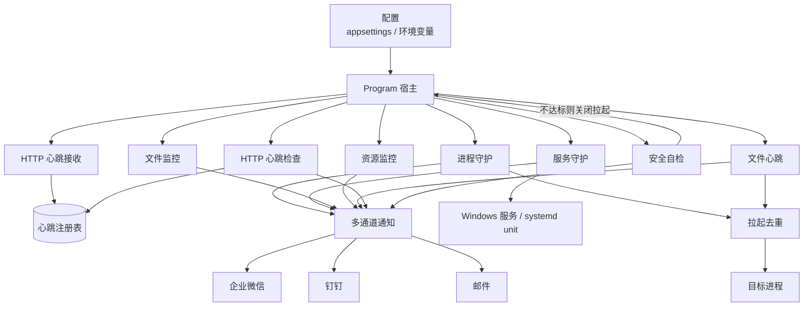

# NightWatch

[](LICENSE)

跨平台看门狗服务（Windows / Linux）。以 Windows LocalSystem 或 Linux root 运行时，可监控进程、系统服务（Windows 服务 / systemd unit）、日志文件、系统资源和心跳，异常时告警，并可按配置自动拉起目标。

通知支持企业微信、钉钉（加签）和 SMTP 邮件，可同时启用；告警按规则冷却，恢复时推送一次通知。告警标题前缀为「守夜人」。

完整配置模板见 `src/NightWatch/appsettings.example.json`（发布目录中同样带有该文件）。

## 目录

- [环境要求](#环境要求)
- [功能](#功能)
- [架构](#架构)
- [部署](#部署)
- [配置说明](#配置说明)
- [运维](#运维)
- [常见问题](#常见问题)
- [项目结构](#项目结构)
- [开发](#开发)

## 环境要求

### Windows

- Windows 10 / Windows Server 2016 或更新
- 框架依赖发布：目标机安装 [.NET 10 运行时](https://dotnet.microsoft.com/download)（含 ASP.NET Core）
- 自包含发布：目标机不必装运行时，体积更大
- 注册服务、自动启动其他 Windows 服务：管理员权限
- 建议安装到非系统盘，例如 `D:\NightWatch`
- 配置里的路径一律用**绝对路径**。服务工作目录是 `C:\Windows\System32`，相对路径会指错位置

### Linux

- 主流发行版（systemd 系：Ubuntu 20.04+、Debian 11+、CentOS/RHEL 8+ 等）
- 框架依赖发布：目标机安装 [.NET 10 运行时](https://dotnet.microsoft.com/download)（含 ASP.NET Core）
- 注册 systemd unit、自动启动其他服务：root 权限
- 建议安装到 `/opt/nightwatch`
- 配置里的路径一律用**绝对路径**（如 `/opt/myapp/myapp`、`/var/log/myapp`）
- 服务守护的 `ServiceName` 填 **systemd unit 名**（如 `nginx`、`myapp.service`）

## 功能

| 模块 | 监控内容 | 异常动作 |
|------|----------|----------|
| 进程守护 | 进程是否存活、窗口是否无响应（后者仅 Windows） | 告警；配置了可执行路径则可拉起 / 强杀重启 |
| 服务守护 | Windows 服务 / systemd unit 是否停止 | 告警；`AutoRestart` 与 `AllowLaunch` 都为 true 时启动或继续 |
| 文件监控 | 日志停更、文件过大 | 告警 |
| 文件心跳 | 心跳文件超过阈值未更新 | 告警；配置了可执行路径则可结束旧进程并拉起 |
| HTTP 心跳 | 多产品、多用户上报超时 | 告警 |
| 资源监控 | CPU、内存、磁盘剩余空间 | 告警 |

未配置的模块不会启动。进程与文件心跳同时守护同一可执行文件时，按路径去重，避免拉起双实例。自动拉起若持续没能让目标恢复健康，会按尝试次数退避（含启动成功但马上又退出的次数），达到上限后停止拉起并要求人工处理。启动时已健康的规则不推送；从异常恢复时推送一次。

所有监控都支持按时间段生效（见「监控时段」）：时段外可以只静默通知、继续自愈，也可以完全停止检查，不必 24 小时盯着。

## 架构

未配置的模块不会注册。进程守护与文件心跳拉起同一可执行文件时，经去重协调器共用一次启动权。通知进入有界队列后由后台并行发送，单通道失败不影响其他通道，也不会拖住监控检查。



## 部署

以下命令在**管理员**命令提示符或 PowerShell 中执行。把 `D:\NightWatch` 换成实际安装目录。Linux 部署见下方 [Linux 部署](#linux-部署)。

### 发布

开发机安装 [.NET 10 SDK](https://dotnet.microsoft.com/download) 后：

```bat
git clone <仓库地址>
cd NightWatch
dotnet publish src\NightWatch -c Release -r win-x64 --self-contained false -o D:\NightWatch
```

框架依赖：目标机安装 .NET 10 运行时即可，不必装 SDK。

> 发布产物**不包含** `appsettings.json` / `appsettings.Development.json`：开发机上的 `appsettings.json` 含真实凭据，若进包会在解压时覆盖服务器配置（2026-10-25 踩过一次）。包里只有 `appsettings.example.json`，首次部署按下一节复制改名；升级时保留服务器上现有的 `appsettings.json`。
>
> 项目里另有 `EnsureNoLocalConfigInPublish` 兜底：它只检查**本次发布要从项目复制出去的文件**，不看目标目录已有内容，因此 `dotnet publish -o <安装目录>` 这种升级方式不会被误拦；一旦发布计划里又出现 `appsettings*.json`（示例文件除外），发布直接失败。

目标机不能装运行时时，改为自包含：

```bat
dotnet publish src\NightWatch -c Release -r win-x64 --self-contained true -o D:\NightWatch
```

也可从 GitHub Actions 的 `NightWatch-win-x64` 制品下载后解压到安装目录（框架依赖）。

### 编写配置

```bat
copy D:\NightWatch\appsettings.example.json D:\NightWatch\appsettings.json
notepad D:\NightWatch\appsettings.json
```

`appsettings.json` 含凭据，不要提交到 Git。按环境删掉不用的规则和通道，不要留示例路径。每条规则的 `Name` 在同类中必须唯一。配置文件允许 `//` 注释。

上线前先在前台跑一次，确认配置能加载：

```bat
cd /d D:\NightWatch
NightWatch.exe
```

控制台无报错后 `Ctrl+C` 退出，再注册为服务。

### 验证通知

至少配置一个通知通道后：

```bat
NightWatch.exe --test-notify
NightWatch.exe --test-notify --test-message "主机A通知通道验证"
```

到对应群或邮箱确认能收到消息。退出码可直接用于脚本判断：全部通道成功为 `0`，任一通道失败或没有可用通道为 `1`（原因逐条打印）。QQ 邮箱使用 SMTP 授权码，不是登录密码；587 端口配合 `"UseSsl": false`（STARTTLS），465 配合 `"UseSsl": true`。

### 收紧目录权限

安装目录、被守护程序目录、心跳文件目录都不要对 Users / Everyone 开放写权限。更新程序用专用部署组：

```bat
net localgroup APP_DEPLOYERS /add
net localgroup APP_DEPLOYERS 运维账号 /add
icacls D:\NightWatch /inheritance:r /grant:r "Administrators:(OI)(CI)F" /grant:r "SYSTEM:(OI)(CI)F" /grant:r "Users:(OI)(CI)RX"
icacls D:\apps\myapp /inheritance:r /grant:r "Administrators:(OI)(CI)F" /grant:r "SYSTEM:(OI)(CI)F" /grant:r "APP_DEPLOYERS:(OI)(CI)M" /grant:r "Users:(OI)(CI)RX"
```

自检只拦截内置宽泛组。自定义组（如 `APP_DEPLOYERS`）可写不会被禁用拉起。

### 开启安全自检

NightWatch 默认以 SYSTEM 按配置拉起进程。目标 exe 或配置文件对普通用户可写时，存在本地提权风险。

多用户机器建议打开自检。**关闭权只认环境变量或命令行**，不要写在 `appsettings.json` 里：

```bat
setx WatchDog__EnableStartupSecurityCheck true /M
```

单管理员机器可设 `false`，或不设（默认关闭）。修改系统环境变量后需要重启服务才能生效。

自检开启后：用 SID 检查安装目录、全部 `appsettings*.json`、规则里的可执行文件和心跳文件。宽泛组可写、所有者不是 SYSTEM/Administrators、或 ACL 读失败时，**只关闭自动拉起**，监控和告警继续。开发环境（`dotnet run`）不检查安装目录和配置文件，避免 bin 目录误报。

配置或安装目录不可信时，文件里的 `"EnableStartupSecurityCheck": false` 无效。

### 注册服务

```bat
sc create NightWatch binPath= "D:\NightWatch\NightWatch.exe" start= auto
sc description NightWatch "NightWatch 看门狗服务"
sc start NightWatch
sc query NightWatch
```

`binPath=` 后面的空格不能少。服务账户保持 LocalSystem，以便拉起进程和启动其他服务。

若提示服务已存在：先 `sc stop NightWatch` 再 `sc delete NightWatch`，然后重新 create。

### 确认运行

```bat
sc query NightWatch
dir D:\NightWatch\logs
```

日志在安装目录 `logs\nightwatch-*.log`，按天滚动，保留 30 天。启动横幅会打印已加载的规则数量和通知通道。

若自检禁用了拉起，日志中有 `[安全自检]`，告警也会带 `icacls` 示例。收紧权限后重启服务即可恢复拉起。

### 更新

保留现有 `appsettings.json` 和 `logs`，只替换程序文件：

```bat
sc stop NightWatch
dotnet publish src\NightWatch -c Release -r win-x64 --self-contained false -o D:\NightWatch
sc start NightWatch
```

发布产物里没有 `appsettings.json`（构建时已排除），所以直接 `dotnet publish -o <安装目录>` 覆盖程序文件不会动到生产配置。守卫只看本次发布计划里从项目复制的文件，目标目录原有的生产配置不会被误判；若将来复制规则又被加回来，发布会直接失败而不是悄悄覆盖。

### 卸载

```bat
sc stop NightWatch
sc delete NightWatch
```

再按需删除 `D:\NightWatch`。系统环境变量可保留，或：

```bat
reg delete "HKLM\SYSTEM\CurrentControlSet\Control\Session Manager\Environment" /v WatchDog__EnableStartupSecurityCheck /f
```

### Linux 部署

以下命令以 root 执行。把 `/opt/nightwatch` 换成实际安装目录。

#### 发布（Linux）

开发机或 CI 上：

```bash
dotnet publish src/NightWatch -c Release -r linux-x64 --self-contained false -o /opt/nightwatch
```

自包含（目标机不装运行时）：

```bash
dotnet publish src/NightWatch -c Release -r linux-x64 --self-contained true -o /opt/nightwatch
```

也可从 GitHub Actions 的 `NightWatch-linux-x64` 制品下载后解压到安装目录。

> 从 Windows 交叉发布（`-r linux-x64`）或经 zip 传输时，**可执行位会丢失**：解压后执行 `chmod +x /opt/nightwatch/NightWatch`，否则 systemd 启动会报 `Permission denied`。框架依赖发布同样需要 apphost 可执行；也可在 unit 里改用 `ExecStart=/usr/bin/dotnet /opt/nightwatch/NightWatch.dll` 绕开。

#### 编写配置（Linux）

```bash
cp /opt/nightwatch/appsettings.example.json /opt/nightwatch/appsettings.json
vi /opt/nightwatch/appsettings.json
```

与 Windows 的差异：
- 所有路径写 Linux 绝对路径（`/opt/myapp/myapp`、`/var/log/myapp`）
- `Resources.Disks[].Drive` 填挂载点（`/`、`/data`），不是盘符
- `Services[].ServiceName` 填 systemd unit 名（`nginx` 或 `myapp.service`）
- 通知、心跳、文件监控等配置与 Windows 完全一致

#### 收紧目录权限（Linux）

安装目录、被守护程序目录、心跳文件目录都不要对普通用户开放写权限：

```bash
chown -R root:root /opt/nightwatch /opt/myapp /var/lib/myapp
chmod -R go-w /opt/nightwatch /opt/myapp /var/lib/myapp
```

自检只拦截「other 可写」和「普通登录用户属主（uid ≥ 1000）」。自定义属组可写（`chgrp deployers` + `g+w`）不会被禁用拉起。

注意：**不检测 POSIX ACL（`setfacl`）与属组可写**，这两类写权限需要人工保证。属主 uid ≥ 1000 一律视为不可信——安装目录务必 `chown root:root`，否则自检会关掉全部自动拉起。

#### 开启安全自检（Linux）

推荐写进 unit（持久、可审计）：

```bash
systemctl edit nightwatch
```

```ini
[Service]
Environment=WatchDog__EnableStartupSecurityCheck=true
```

临时验证也可以用 `systemctl set-environment WatchDog__EnableStartupSecurityCheck=true`，但它只存在于运行中的 systemd manager，**重启机器后会丢失**，安全自检会悄悄回到默认关闭——不要作为长期配置。

规则与 Windows 相同：**关闭权只认环境变量或命令行**，不要写在 `appsettings.json` 里。自检开启后用权限位与属主 uid 检查：其他用户可写、属主是普通登录用户（uid ≥ 1000）、或权限读失败时，**只关闭自动拉起**，监控和告警继续。开发环境（`dotnet run`）不检查安装目录和配置文件。

#### 注册 systemd 服务

写 unit 文件 `/etc/systemd/system/nightwatch.service`：

```ini
[Unit]
Description=NightWatch 看门狗服务
After=network.target

[Service]
Type=notify
WorkingDirectory=/opt/nightwatch
ExecStart=/opt/nightwatch/NightWatch
Restart=always
RestartSec=5

[Install]
WantedBy=multi-user.target
```

框架依赖发布时 `ExecStart` 也可写成 `ExecStart=/usr/bin/dotnet /opt/nightwatch/NightWatch.dll`。

```bash
systemctl daemon-reload
systemctl enable --now nightwatch
systemctl status nightwatch
```

`Type=notify` 与 `AddSystemd` 配合，进程就绪后才报告启动完成。

#### 确认运行（Linux）

```bash
systemctl status nightwatch
ls /opt/nightwatch/logs
```

日志在安装目录 `logs/nightwatch-*.log`，按天滚动，保留 30 天。

#### 更新（Linux）

保留现有 `appsettings.json` 和 `logs`，只替换程序文件：

```bash
systemctl stop nightwatch
dotnet publish src/NightWatch -c Release -r linux-x64 --self-contained false -o /opt/nightwatch
chmod +x /opt/nightwatch/NightWatch   # 从 Windows 交叉发布/zip 传输后必须补执行位
systemctl start nightwatch
```

#### 卸载（Linux）

```bash
systemctl disable --now nightwatch
rm /etc/systemd/system/nightwatch.service
systemctl daemon-reload
```

再按需删除 `/opt/nightwatch`。环境变量可保留，或：

```bash
rm -rf /etc/systemd/system/nightwatch.service.d   # 若用 systemctl edit 写过 Environment=
```

## 配置说明

全部选项在 `appsettings.json` 的 `WatchDog` 节。不需要的数组留空或不写，对应监控器不会启动。

Windows 用 `appsettings.example.json`，Linux 用 `appsettings.example.linux.json`：后者路径是 `/opt/myapp`、`/var/log/myapp` 风格，`Resources.Disks[].Drive` 填挂载点（`/`），`Services[].ServiceName` 填 systemd unit 名（`myapp.service`）。

| 节 | 作用 | 主要字段 |
|----|------|----------|
| `Notify.Channels` | 通知通道，可叠加 | `Type`：`wecom` / `dingtalk` / `email` |
| `Processes` | 进程守护 | `Name`、`ProcessName`、`FilePath`（空则只告警）、`Arguments`、`WorkingDirectory`、`RestartIfNotResponding`（仅 Windows 生效） |
| `Services` | 服务守护 | `Name`、`ServiceName`（Windows 为 `sc query` 的服务名；Linux 为 systemd unit 名）、`AutoRestart`、`AllowLaunch` |
| `Files` | 文件 / 日志 | `Name`、`Path`、`Pattern`、`StaleMinutes`（0 关闭）、`MaxSizeMB`（0 关闭） |
| `FileHeartbeats` | 文件心跳 | `Name`、`HeartbeatFile`、`StaleMinutes`、可选 `ProcessName` / `FilePath` |
| `HttpHeartbeat` | HTTP 心跳 | 见下文 |
| `Resources` | 资源 | `CpuPercent`、`MemoryPercent`（0 关闭）、`Disks`（Windows 填盘符 `C:`，Linux 填挂载点 `/`） |

监控项通用字段：`IntervalSeconds`（最短 5 秒）、`CooldownMinutes`。每条规则按自己的间隔检查。存活判定和结束进程以可执行文件完整路径为准，不用同名进程冒充；配置了 `FilePath` 时会按可执行文件名自动枚举，因此 `ProcessName` 与实际文件名不一致也不会漏判。

每条规则还可以用 `Schedule` 限定监控/告警时段（见下节），不写则继承全局设置。

### 监控时段（不必 24 小时运行）

不配置时所有规则 24 小时生效。需要「只在工作时间监控」或「夜间免打扰」时，用 `Schedule` 限定：

```jsonc
"Schedule": {
  "Mode": "NoAlert",
  "Windows": [
    { "Days": ["Mon", "Tue", "Wed", "Thu", "Fri"], "Start": "08:30", "End": "18:30" },
    { "Days": ["Sat"], "Start": "09:00", "End": "12:00" }
  ]
}
```

`Mode` 决定时段外的行为：

| Mode | 时段外行为 | 适用场景 |
|------|------------|----------|
| `NoAlert`（默认） | 继续检查、继续自动拉起，**只静默外部通知**（日志照常记录） | 夜间不打扰，但故障仍要自愈 |
| `Off` | 完全停止该规则的检查：不告警、不拉起 | 非工作时段根本不需要监控 |

语义：

- 按**服务器本地时间**判定，区间为 `[Start, End)`：`Start` 含、`End` 不含。
- `Start` 大于 `End` 表示**跨零点**（如 `22:00`-`06:00`），此时 `Days` 指**开始那天**：「周一 22:00-06:00」包含周二凌晨 3 点。
- `Days` 写 `Mon` / `Monday` / `1`（周一=1）或「周一」均可；留空表示每天。
- `Start` 与 `End` 相同表示**整天**。
- 时段外被静默的告警**不占用冷却**：回到时段内若仍异常，会立即推送一次。
- 时段切换会写一条 `INF` 日志（进入/退出监控时段），便于确认当前状态。
- 配置解析失败时按**全天生效**处理（启动日志有 `WRN`），避免「配置写错导致静默不监控」。

作用范围：写在 `WatchDog.Schedule` 是全局默认；写在单条规则（`Processes` / `Services` / `Files` / `FileHeartbeats` / `Resources` / `HttpHeartbeat`）里覆盖全局。想让某条规则摆脱全局时段，给它写空的 `"Schedule": { "Windows": [] }` 即可。
常用场景：**只在 A 股开盘时段监控**（工作日 09:30-11:30、13:00-15:00，其余时间这条规则完全不动）：

```jsonc
"Processes": [
  {
    "Name": "交易终端",
    "ProcessName": "TradingApp",
    "FilePath": "D:\\apps\\TradingApp\\TradingApp.exe",
    "Schedule": {
      "Mode": "Off",
      "Windows": [
        { "Days": ["Mon", "Tue", "Wed", "Thu", "Fri"], "Start": "09:30", "End": "11:30" },
        { "Days": ["Mon", "Tue", "Wed", "Thu", "Fri"], "Start": "13:00", "End": "15:00" }
      ]
    }
  }
]
```

`Mode: "Off"` = 只在窗口内监控、拉起、告警；收盘后不检查也不打扰。若希望收盘后仍监控、只是不发告警，把 `Mode` 改成 `NoAlert`。

> 目前只按星期过滤，法定节假日会照常监控；需要按交易日历时可以加一份跳过日期列表。

> `HttpHeartbeat` 在 `Off` 时段不检查，但上报照常接收；时段恢复后的第一轮会对整夜未上报的键补发告警。

### 通知通道

```jsonc
"Notify": {
  // 多台机器推到同一个群时建议填写，告警正文会带「主机：xxx」；不写则用计算机名
  "HostLabel": "交易机-A",
  "Channels": [
    {
      "Type": "wecom",
      "Name": "企业微信群",
      "WebhookUrl": "https://qyapi.weixin.qq.com/cgi-bin/webhook/send?key=xxx"
    },
    {
      "Type": "dingtalk",
      "Name": "钉钉群",
      "WebhookUrl": "https://oapi.dingtalk.com/robot/send?access_token=xxx",
      "Secret": "SECxxxx"
    },
    {
      "Type": "email",
      "Name": "邮件告警",
      "SmtpHost": "smtp.qq.com",
      "SmtpPort": 587,
      "UseSsl": false,
      "Username": "you@qq.com",
      "Password": "SMTP授权码",
      "From": "you@qq.com",
      "To": ["boss@qq.com"]
    }
  ]
}
```

钉钉机器人若启用加签，必须填 `Secret`。邮件未配 `SmtpHost` 时该通道会被跳过并记日志。各通道并行发送，互不影响。

`HostLabel` 与 IP 会出现在企微/钉钉 markdown 与邮件正文：标题**之前**各占一行「主机：…」「IP：…」，多台机器同一个群时第一眼就能区分来源。未配置 `HostLabel` 时主机名用 `Environment.MachineName`。默认 `IncludeHostIp` 为 true，发送时解析本机首个可用 IPv4（带 30 秒缓存，DHCP 续租/网卡切换后不会一直推旧地址）；不需要 IP 时设 `"IncludeHostIp": false`。

### 进程守护

```jsonc
"Processes": [
  {
    "Name": "业务主程序",
    "ProcessName": "myapp",
    "FilePath": "D:\\apps\\myapp\\myapp.exe",
    "Arguments": "",
    "WorkingDirectory": "D:\\apps\\myapp",
    "IntervalSeconds": 30,
    "CooldownMinutes": 10,
    "RestartIfNotResponding": false
  }
]
```

`FilePath` 为空则只告警不拉起。`RestartIfNotResponding` 仅对有窗口的进程有效，**Linux 没有窗口概念，该开关恒不生效**（不报错，也不会因此重复拉起）。强杀重启同样受 `AllowLaunch` 与退避熔断约束：安全自检禁用拉起、或连续拉起已达上限时只告警、不结束进程，避免把目标留在「已死且不会拉起」的状态。`WorkingDirectory` 留空（或不写）时，子进程工作目录为可执行文件所在目录。

### 服务守护

```jsonc
"Services": [
  {
    "Name": "业务服务",
    "ServiceName": "MyService",
    "AutoRestart": true,
    "IntervalSeconds": 60,
    "CooldownMinutes": 10
  }
]
```

`ServiceName` 在 Windows 上必须是 `sc query` 里的服务名（不是显示名），在 Linux 上填 systemd unit 名（`nginx` 或 `myapp.service`）。Windows 上暂停状态会执行继续，停止状态会执行启动；Linux 上 systemd 无暂停态，停止/失败即拉起。`AllowLaunch` 默认 true，旧配置不写该字段时行为不变。安全自检判定安装目录或配置不可信时会把它设为 false，此时只告警、不启动服务（与进程守护、文件心跳同一道闸门）。也可以在配置里显式写 `"AllowLaunch": false`。

### 文件监控

```jsonc
"Files": [
  {
    "Name": "业务日志",
    "Path": "D:\\logs\\myapp",
    "Pattern": "*.log",
    "StaleMinutes": 10,
    "MaxSizeMB": 500,
    "IntervalSeconds": 60,
    "CooldownMinutes": 30
  }
]
```

`Path` 可以是文件或目录。目录时按 `Pattern` 取最近修改的文件。

### 文件心跳

适用于与 NightWatch 同一台机器的进程。被监控程序定期更新文件即可：

```csharp
File.WriteAllText(@"D:\data\heartbeat.txt", DateTime.Now.ToString());
```

```jsonc
"FileHeartbeats": [
  {
    "Name": "业务心跳",
    "HeartbeatFile": "D:\\data\\heartbeat.txt",
    "StaleMinutes": 5,
    "ProcessName": "myapp",
    "FilePath": "D:\\apps\\myapp\\myapp.exe",
    "IntervalSeconds": 60,
    "CooldownMinutes": 10
  }
]
```

超过 `StaleMinutes` 未更新视为失联。只有配置了 `FilePath` 才会结束旧进程并拉起；只配 `ProcessName` 不会杀进程。

### HTTP 心跳

适用于多产品、多客户端。NightWatch 内嵌 HTTP 服务，默认 `localhost:5200`。

```
POST http://<主机>:5200/heartbeat/{product}/{user}
GET  http://<主机>:5200/heartbeats
```

只接受 POST 上报。配置了 `Token` 时，请求须带 `X-NightWatch-Token`、`Authorization: Bearer <token>` 或 `?token=` 之一。

```bat
curl -X POST "http://127.0.0.1:5200/heartbeat/MyApp/userA" -H "X-NightWatch-Token: 你的令牌"
```

```csharp
using var timer = new PeriodicTimer(TimeSpan.FromMinutes(1));
while (await timer.WaitForNextTickAsync())
    await httpClient.PostAsync("http://192.168.1.10:5200/heartbeat/MyApp/userA?token=你的令牌", null);
```

```jsonc
"HttpHeartbeat": {
  "Enabled": true,
  "Host": "localhost",
  "Port": 5200,
  "Token": "换成随机长令牌",
  "StaleMinutes": 5,
  "IntervalSeconds": 60,
  "CooldownMinutes": 10,
  "RetentionMinutes": 60,
  "Expected": ["MyApp/userA"],
  "Products": [
    { "Name": "MyApp", "StaleMinutes": 2 }
  ]
}
```

`Host` 保持 `localhost` 时，只有本机可上报。要收其他机器的心跳时改为 `0.0.0.0`，必须配置 `Token`，并放行入站端口：

```bat
netsh advfirewall firewall add rule name="NightWatch HTTP" dir=in action=allow protocol=TCP localport=5200
```

对外监听却没配 `Token` 时，接收端会拒绝启动并记 ERR（不会裸奔），其余监控照常运行。

`MaxKeys` 限制保留的动态键数量（默认 10000）：product / user 单段超过 128 字符返回 400，容量满后新键返回 429（已有键仍可刷新）。`/heartbeats` 查询同样需要 Token。

动态键超过 `RetentionMinutes` 未上报会移除；仍在 `Expected` 中的键按「必达缺失」继续告警。

端口被占用（或绑定失败）时，接收端会降级关闭并在日志记一条 `ERR`，进程/服务/资源监控仍继续运行，只是收不到 HTTP 上报；排查端口占用后重启服务即可恢复。

### 资源监控

```jsonc
"Resources": {
  "IntervalSeconds": 60,
  "CooldownMinutes": 30,
  "CpuPercent": 90,
  "MemoryPercent": 90,
  "Disks": [
    { "Drive": "C:", "MinFreeGB": 10 }
  ]
}
```

阈值为 `0` 的项不检查。未配置任何磁盘且 CPU/内存都为 0 时，资源监控器不启动。`Disks[].Drive` 在 Windows 写盘符（`C:`），Linux 写挂载点（`/`、`/data`）。CPU/内存采集：Windows 用性能计数器与 `GlobalMemoryStatusEx`，Linux 读 `/proc/stat` 与 `/proc/meminfo`。

Linux 上内存优先读 **cgroup v2** 限额（`/sys/fs/cgroup/memory.current` ÷ `memory.max`），容器里得到的是本容器的使用率；`memory.max` 为 `max`（无限额）或读不到时回退 `/proc/meminfo`（宿主机口径）。CPU 的 `guest` / `guest_nice` 不会重复计入（内核已把它们算进 `user` / `nice`）。

## 运维

| 操作 | Windows | Linux |
|------|---------|-------|
| 启动 | `sc start NightWatch` | `systemctl start nightwatch` |
| 停止 | `sc stop NightWatch` | `systemctl stop nightwatch` |
| 状态 | `sc query NightWatch` | `systemctl status nightwatch` |
| 前台调试 | 先 `sc stop NightWatch`，再在安装目录运行 `NightWatch.exe` | 先 `systemctl stop nightwatch`，再在安装目录运行 `./NightWatch` |
| 看日志 | `D:\NightWatch\logs\nightwatch-*.log` | `/opt/nightwatch/logs/nightwatch-*.log` |
| 改配置 | 编辑 `appsettings.json` 后 `sc stop` / `sc start` | 编辑 `appsettings.json` 后 `systemctl restart nightwatch` |

改系统环境变量后必须重启服务。日志级别为 Information。每条规则的异常，以及从异常恢复，会写入文件；持续健康的轮询结果是 Debug，避免正常运行时刷屏。

告警经有界队列（默认 256 条）异步投递：队列满时丢弃并记 WRN，停机时最多等 5 秒排空，避免 SMTP 超时拖住监控。恢复通知只在本次异常期间确实推送过告警时发送。

## 常见问题

**服务无法启动，或启动后立刻退出。** 先在安装目录前台运行（Windows: `NightWatch.exe`；Linux: `./NightWatch`）看报错。常见原因：未安装 .NET 10 运行时、`appsettings.json` 不是合法 JSON。

**HTTP 心跳接口端口被占用。** 日志出现「HTTP 心跳服务启动失败…接收端已降级关闭」。看门狗本身继续运行，其余监控不受影响，只是收不到 HTTP 心跳上报；释放端口后重启服务。

**日志目录写不出来。** 安装目录对服务账户（Windows: SYSTEM；Linux: root）没有写权限。按「收紧目录权限」授权。

**进程明明在跑，看门狗还在拉起。** 存活按映像完整路径匹配。`FilePath` 必须与进程主模块路径完全一致（Windows 含盘符、大小写不敏感；Linux 大小写敏感）。

**配置了拉起却没有启动目标。** 日志里若有 `[安全自检]`，说明路径对宽泛组可写或属主不可信，拉起已被关闭。收紧权限后重启服务。`FilePath` 为空的规则本来就不会拉起。

**找不到目标文件或心跳文件。** 服务工作目录不是安装目录（Windows 是 `System32`，Linux 由 unit 的 `WorkingDirectory` 决定）。所有路径写成绝对路径。

**HTTP 上报返回 401。** 请求未带 Token，或 Token 与配置不一致（长度不同同样返回 401，不会变成 500）。

**跨机器心跳连不上。** `Host` 是否为 `0.0.0.0`、本机防火墙是否放行端口、对端能否访问该端口（Linux 放行示例：`firewall-cmd --add-port=5200/tcp --permanent` 或 `ufw allow 5200/tcp`）。

**邮件收不到。** 确认授权码、端口与 `UseSsl` 组合，以及出站 587/465 是否被拦。可用 `--test-notify` 单独测通道。

**服务名找不到。** Windows 上 `ServiceName` 要用 `sc query` 的内部名，不是服务管理器里的显示名；Linux 上要用 `systemctl list-units` 里的 unit 名。

## 项目结构

```
src/
├── NightWatch/
│   ├── Program.cs                     # 宿主：日志、配置、安全自检、按规则注册监控器
│   ├── appsettings.example.json       # 配置模板（复制为 appsettings.json）
│   ├── Models/
│   │   └── WatchDogOptions.cs         # 配置模型
│   ├── Platform/                      # 跨平台抽象（Windows / Linux 实现）
│   │   ├── PlatformServices.cs        # 按 OS 选择实现、路径比较规则
│   │   ├── IServiceControl.cs         # 服务单元控制接口
│   │   ├── ServiceUnitStatus.cs       # 统一服务状态枚举
│   │   ├── WindowsServiceControl.cs   # Windows 服务（ServiceController）
│   │   ├── SystemdServiceControl.cs   # systemd unit（systemctl）
│   │   ├── ISystemMetrics.cs          # 资源采集接口
│   │   ├── WindowsSystemMetrics.cs    # 性能计数器 / GlobalMemoryStatusEx
│   │   ├── LinuxSystemMetrics.cs      # /proc/stat、/proc/meminfo
│   │   ├── IPermissionAuditor.cs      # 权限审计接口
│   │   ├── WindowsAclAuditor.cs       # SID / ACL 判定
│   │   └── LinuxPermissionAuditor.cs  # 属主 uid + 权限位判定
│   ├── Security/
│   │   ├── SecuritySwitch.cs          # 自检开关（环境变量 / 命令行）
│   │   ├── StartupSecurityCheck.cs    # 启动权限自检
│   │   ├── AclEvaluator.cs            # Windows SID / Allow-Deny / 所有者判定
│   │   └── RuleNameGuard.cs           # 规则 Name 非空且唯一
│   ├── Heartbeat/
│   │   ├── HeartbeatRegistry.cs       # HTTP 心跳注册表
│   │   ├── HeartbeatApiService.cs     # 接收 HTTP 上报
│   │   ├── HttpHeartbeatMonitor.cs    # HTTP 心跳超时检查
│   │   └── FileHeartbeatMonitor.cs    # 文件心跳
│   ├── Monitoring/
│   │   ├── PollingMonitorBase.cs      # 轮询、冷却、恢复通知
│   │   ├── ProcessLaunchCoordinator.cs# 跨监控器拉起去重
│   │   ├── RestartBackoff.cs          # 进程 / 文件心跳共用的拉起退避
│   │   ├── ProcessImage.cs            # 按映像路径识别 / 结束进程
│   │   ├── ProcessMonitor.cs          # 进程守护
│   │   ├── ServiceMonitor.cs          # 服务守护（Windows 服务 / systemd unit）
│   │   ├── FileLogMonitor.cs          # 文件 / 日志
│   │   └── ResourceMonitor.cs         # CPU / 内存 / 磁盘
│   └── Notification/
│       ├── IEventNotifier.cs
│       ├── MultiChannelNotifier.cs    # 多通道并行分发
│       ├── ChannelSenders.cs          # 企业微信 / 钉钉
│       └── EmailSender.cs             # SMTP 邮件
└── NightWatch.Tests/                  # 单测（ACL、权限位、/proc 解析、开关、心跳鉴权、拉起去重等）
```

## 开发

```bat
dotnet run --project src\NightWatch
dotnet test src\NightWatch.Tests
```

发布流程（版本号、打 tag、双平台 Release、制品校验与回滚）见 `docs/release-checklist.md`；踩过的坑与检查清单见 `docs/lessons-learned.md`。

Linux / macOS 上同样的命令（开发主要在 Windows 进行，但代码可在任意平台编译测试）。

`Properties/launchSettings.json` 会把环境设为 Development，此时不检查安装目录和配置文件的权限。

新增监控类型：在 `WatchDogOptions` 增加规则 → 继承 `PollingMonitorBase` 并实现 `CheckAllAsync` → 用 `ReportAsync` 上报 → 在 `Program.cs` 按条件 `AddHostedService`。涉及平台差异时在 `Platform/` 下加接口与双实现，不要直接在监控器里调 Windows/Linux API。

## 开源协议

本项目基于 [MIT License](LICENSE) 开源。Copyright (c) 2026 守夜人 (NightWatch)。
